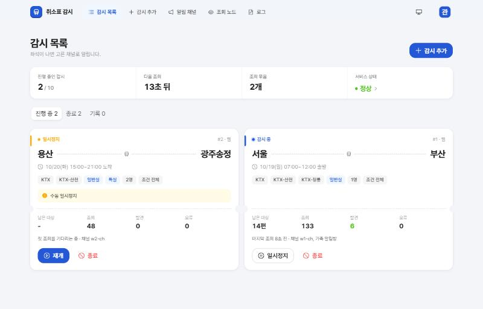
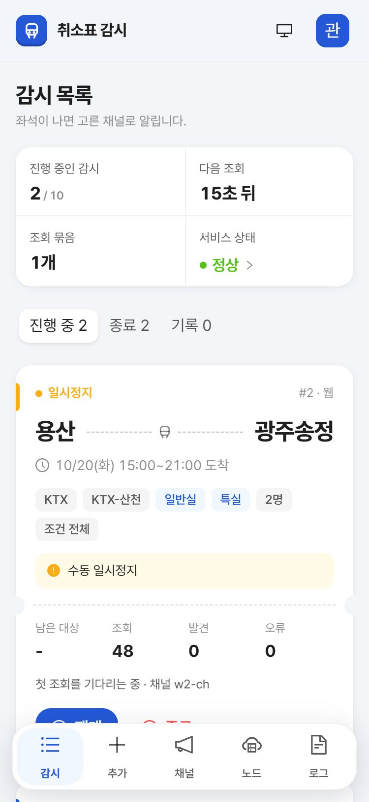

# 취소표 감시

코레일 열차(KTX·ITX·새마을·무궁화)의 취소표를 감시해서 Discord·Telegram으로 알려주는 셀프 호스팅 서비스입니다.
웹 화면(Discord 로그인)과 Discord 슬래시 명령으로 감시를 등록하고 관리합니다. 좌석을 알려주기만 하고 예매는 하지 않습니다.

<p align="center">
  
  
</p>

> **주의:** 코레일과 관계없는 비공식 도구입니다. 문서화되지 않은 코레일 앱 API([pykorail](https://github.com/devgyurak/pykorail))를 쓰기 때문에 앱이 바뀌면 멈출 수 있습니다.
> 과도한 자동 요청은 제재 대상이 될 수 있으니 조회 간격 설정을 줄이지 마세요. 이용 약관과 관련 법령을 지키는 것은 사용자 책임입니다.

## 주요 기능

- **열차 조회**: 출발·도착역, 구간(최대 3일), 인원수로 조회합니다. 시간표를 먼저 보여주고, 좌석(예약 가능·부족·매진)은 코레일에서 받는 대로 채웁니다.
- **역 선택**: 검색하거나 지도에서 고릅니다. 출발역을 고르면 갈아타지 않고 갈 수 있는 도착역만 켜지고, 지도에 열차 경로와 편수가 나옵니다.
- **감시**: 조건 전체 또는 고른 열차만 감시합니다. 좌석이 나면 알리고, 다시 매진되면 다음에 또 알립니다. 출발 60분 전이 지난 열차는 빼고, 대상이 남지 않으면 스스로 끝납니다.
- **알림 채널**: Discord 전용 채널(봇이 감시마다 만들고, 고른 멤버만 볼 수 있음), Discord 웹훅, Telegram 채널·그룹.
- **Discord 명령**: `/watch add 출발 도착 시작일 [끝날짜]`, `/watch list`, `/watch stop 번호`
- **관리**: 감시 상세(열람자 변경, 종료·재개), 채널 목록, 서비스 상태, 로그(토큰·웹훅 주소 등은 가려서 남김). 라이트·다크 테마, 모바일 화면을 지원합니다.
- **코레일 요청 조절**: 같은 노선·날짜의 감시는 한 번에 조회합니다. 요청은 한 줄로 세워 간격을 두고, 코레일 앱처럼 정시 단위로 보냅니다. 고른 열차만 감시하면 그 시간대만 조회합니다. 조회가 실패하면 그 사이클의 남은 요청을 보내지 않고, 연속으로 실패하면 한동안 쉽니다.
- **조회 노드(선택)**: 공인 IP가 다른 PC에 노드를 붙이면 노선을 나눠 조회하고, 워커 수만큼 조회 간격이 줄어듭니다(IP 하나당 요청 속도는 그대로).

## 빠른 시작

Docker(Compose v2)만 있으면 됩니다.

```bash
git clone https://github.com/mangddung/ktx-watcher.git && cd ktx-watcher
cp .env.example .env      # 아래 "설정" 표를 보고 채운다(Discord 앱이 필요하다)
docker compose up -d --build
```

터널 없이 이 PC에서만 쓰면 `.env` 에서 `COMPOSE_PROFILES` 줄을 지우고 `PUBLIC_BASE_URL=http://localhost:14372` 로 둔 뒤 http://localhost:14372 에 접속합니다.
외부에서 접속하려면 아래 [Cloudflare Tunnel](#2-cloudflare-tunnel-선택)을 설정합니다.

## 구성

| 폴더 | 내용 |
|---|---|
| `backend/` | FastAPI, 감시 스케줄러, Discord 봇, Telegram, SQLite(alembic) |
| `backend/app/data/` | 앱과 함께 배포하는 고정 데이터(역, 지도, 초기 시간표, 열차 종류 표본) |
| `backend/scripts/` | 고정 데이터를 다시 만드는 스크립트(런타임에는 안 돈다) |
| `frontend/` | React + antd 웹 화면. prod 에서는 nginx 가 서빙하고 `/api`, `/auth` 를 백엔드로 넘긴다 |
| `data/` | 실행 중에 생기는 데이터(DB, 갱신한 시간표). 컨테이너 볼륨, 커밋하지 않음 |

## 설정 (`.env`)

`.env.example` 을 `.env` 로 복사해서 채웁니다. `.env` 는 커밋하지 않습니다(`.gitignore`, `.dockerignore` 에 들어 있음).

| 항목 | 필수 | 내용 |
|---|---|---|
| `DISCORD_CLIENT_ID`, `DISCORD_CLIENT_SECRET` | 필수 | 웹 로그인(Discord OAuth) |
| `DISCORD_ADMIN_IDS` | 필수 | 관리자 Discord 사용자 ID, 쉼표로 최대 5명 |
| `SESSION_SECRET` | 필수 | 32자 이상 난수(`python -c "import secrets; print(secrets.token_urlsafe(48))"`) |
| `PUBLIC_BASE_URL` | 필수 | 웹 주소. OAuth 는 `{PUBLIC_BASE_URL}/auth/callback` 으로 돌아온다. https 면 세션 쿠키에 Secure 가 붙는다 |
| `DISCORD_BOT_TOKEN`, `DISCORD_GUILD_ID` | 선택 | 없으면 봇 없이 웹훅 알림만 쓴다 |
| `TELEGRAM_BOT_TOKEN` | 선택 | Telegram 알림 |
| `DATA_GO_KR_KEY` | 선택 | 공공데이터포털 인증키. 있으면 시간표를 주 1회 새로 만든다 |
| `CLOUDFLARE_TUNNEL_TOKEN`, `COMPOSE_PROFILES=tunnel` | 선택 | Cloudflare Tunnel 로 외부 공개 |
| `WATCH_CUTOFF_MINUTES` | 기본 60 | 출발 몇 분 전까지 감시할지 |
| `SCAN_INTERVAL_MIN`, `SCAN_INTERVAL_MAX` | 기본 40, 80 | 감시 사이클 간격(초, 난수) |
| `PAGE_GAP_MIN`, `PAGE_GAP_MAX` | 기본 1, 2 | 코레일 요청 사이 간격(초, 난수) |
| `MAX_FAILS`, `BLOCK_COOLDOWN_MINUTES` | 기본 10, 30 | 연속 실패 몇 번에 몇 분 쉴지 |
| `MAX_ACTIVE_WATCHES`, `MAX_WATCH_DAYS` | 기본 10, 3 | 진행 중인 감시 수, 감시 구간 최대 일수 |
| `LOCAL_SCAN` | 기본 1 | 0 이면 이 서버는 감시 조회를 하지 않고 조회 노드만 쓴다(웹 수동 조회는 계속 이 서버 IP) |
| `LOG_LEVEL` | 기본 INFO | DEBUG 면 페이지별 조회 로그와 스택트레이스까지 |

## 설치와 실행

### 1. Discord 앱

1. https://discord.com/developers/applications 에서 앱을 만든다.
2. **OAuth2**: Client ID, Client Secret 을 `.env` 에 넣고, Redirects 에 `{PUBLIC_BASE_URL}/auth/callback` 을 추가한다.
3. **Bot**: 토큰을 `DISCORD_BOT_TOKEN` 에 넣고 **SERVER MEMBERS INTENT** 를 켠다(열람자 멤버 목록에 필요).
4. 봇을 서버에 초대한다. OAuth2 URL Generator 에서 scope `bot`, `applications.commands`, 권한
   `Manage Channels`, `View Channels`, `Send Messages`, `Read Message History`, `Send Messages in Threads`,
   `Create Public Threads`, `Create Private Threads`, `Add Reactions`, `Manage Roles` 를 고른다. 관리자 권한은 필요 없다.
   하나라도 빠지면 시작 로그에 빠진 권한이 찍힌다. `Manage Roles` 는 이미 만든 채널의 열람자를 바꿀 때만 쓴다.
5. 서버 ID 를 `DISCORD_GUILD_ID`, 관리자 사용자 ID 를 `DISCORD_ADMIN_IDS` 에 넣는다(Discord 설정 > 고급 > 개발자 모드를 켜면 우클릭으로 ID 를 복사할 수 있다).

Telegram 은 @BotFather 로 봇을 만들어 `TELEGRAM_BOT_TOKEN` 에 넣고, 봇을 채널(관리자로)이나 그룹에 추가하면 채널 목록에 자동으로 나타난다.
봇을 아는 사람은 누구나 자기 채팅에 봇을 추가할 수 있으니, 알림 채널을 고를 때 모르는 채팅이 섞이지 않았는지 확인한다.

### 2. Cloudflare Tunnel (선택)

1. Zero Trust 대시보드 > Networks > Tunnels 에서 터널(cloudflared)을 만들고 토큰을 `CLOUDFLARE_TUNNEL_TOKEN` 에 넣는다.
2. Public Hostname 을 추가한다. 도메인은 `PUBLIC_BASE_URL` 과 같게, Service 는 `HTTP` `frontend:80`.
3. Zero Trust > Access > Applications 에서 이 도메인에 접근 정책을 건다. dev 는 vite 개발 서버가 그대로 노출되므로 **반드시** 건다.

터널 없이 로컬로만 쓰려면 `COMPOSE_PROFILES` 줄을 지우고 `PUBLIC_BASE_URL` 을 `http://localhost:14371`(dev) 또는 `http://localhost:14372`(prod)로 두고, Discord OAuth Redirects 에도 그 주소의 `/auth/callback` 을 추가한다.

### 3. 실행

```bash
docker compose up -d --build                          # prod
docker compose -f docker-compose.dev.yml up --build   # dev (코드 수정 즉시 반영)
```

dev 와 prod 는 같은 compose 프로젝트라 한쪽을 `up` 하면 다른 쪽 컨테이너가 교체되고(동시에 뜨지 않는다), **같은 DB(`./data/ktx.db`)를 쓴다.**
운영 중인 서버에서 dev 를 띄우면 dev 코드가 실제 DB 를 마이그레이션하고 실제 채널로 알림을 보낸다.
마이그레이션은 시작할 때 자동으로 적용되니, 큰 변경 전에는 `./data` 를 백업한다. 로그는 `docker compose logs -f backend` 또는 웹의 로그 탭에서 본다.

### 4. 조회 노드 (선택)

공인 IP가 다른 PC에서 코레일 조회를 나눠 맡는다. 같은 PC·같은 공유기 뒤의 노드는 IP가 같아 의미가 없다(웹에 "같은 IP" 경고가 뜬다).
노드는 중앙에 poll 해서 잡을 가져가는 방식이라 노드 PC에 포트를 열 필요가 없다. 중앙은 터널로 공개돼 있어야 한다.

1. **Access 서비스 토큰**(도메인에 Access 를 걸었으면): Zero Trust > Access > Service Auth > Service Tokens 에서 토큰을 만들고 Client ID·Secret 을 적어 둔다.
   그다음 Access > Applications > 이 도메인 앱 > Policies 에 Action `Service Auth`, Include `Service Token` = 방금 만든 토큰인 정책을 추가한다.
   서비스 토큰으로는 Access 만 통과한다. 관리 API 는 여전히 Discord 로그인이 있어야 하고, 노드 API 는 노드 토큰만 받는다.
2. **노드 토큰**: 웹 > 조회 노드 > 노드 추가. 토큰은 발급할 때 한 번만 보인다. 잃어버리면 폐기하고 새로 발급한다.
3. **노드 PC** 에서:

```bash
git clone https://github.com/mangddung/ktx-watcher.git ktx && cd ktx
cp .env.node.example .env.node   # CENTRAL_URL, NODE_TOKEN, CF_ACCESS_CLIENT_ID/SECRET 채우기
docker compose -f docker-compose.node.yml up -d --build
```

중앙을 업데이트하면 노드도 `git pull` 뒤 같은 명령으로 다시 빌드한다. pykorail 버전이 중앙과 다르면 중앙이 잡을 주지 않고 웹에 "버전 불일치"로 나온다.
개발 중에는 `cd backend && CENTRAL_URL=http://localhost:14370 NODE_TOKEN=... python -m app.node` 로 바로 띄운다.

노드 상태(온라인·오프라인·중지됨·쿨다운·차단 의심, 접속 IP, 맡은 노선, 1시간 성공·실패)는 웹의 조회 노드 탭에서 본다.
노드를 끄면(`docker compose stop`, Ctrl+C) 중앙에 종료를 알려 바로 빠지고, 맡던 조회는 다음 사이클에 다른 워커가 맡는다. 이때는 경고하지 않는다.
워커마다 연속 실패·쿨다운을 따로 세서, 노드 하나가 막히면 그 노드만 빠지고 노선은 남은 워커가 맡는다.

## 보안

- **관리자만 접근**: 웹과 API 는 `DISCORD_ADMIN_IDS` 에 있는 Discord 계정만 쓸 수 있고, 권한 확인은 모든 API 에서 백엔드가 한다. 관리자마다 가장 최근 로그인 세션 하나만 유효하다.
- **CSRF**: 세션 쿠키는 `SameSite=Lax`, `HttpOnly`(https 면 `Secure`)이고, 상태를 바꾸는 요청은 커스텀 헤더(`X-Requested-With`)가 있어야 받는다.
- **노드 토큰**: 256비트 난수이고 DB 에는 sha256 만 둔다. 노드가 보낸 결과는 맡긴 조회 범위·형식을 벗어나면 버린다.
- **비밀값**: 토큰·웹훅 주소·채팅 ID 는 로그와 웹 화면에서 가린다. 알림 문구의 `@everyone`·멘션은 울리지 않게 보낸다.
- **웹 서버**: nginx 가 CSP, `X-Frame-Options`, `nosniff`, `Referrer-Policy` 를 붙이고, 클라이언트가 보낸 `X-Forwarded-For` 대신 접속 주소(터널이면 `CF-Connecting-IP`)를 넘긴다. 백엔드 포트는 호스트에 열지 않는다(prod).
- **공개 범위**: 외부에 공개할 때는 Cloudflare Access 같은 앞단 인증을 함께 쓰는 것을 권한다. dev 구성은 개발 서버가 그대로 노출되므로 앞단 인증 없이 공개하지 않는다.

취약점은 공개 이슈 대신 GitHub 의 [비공개 취약점 제보](https://github.com/mangddung/ktx-watcher/security/advisories/new)로 알려 주세요.

## 개발

```bash
cd backend
python -m venv .venv
.venv/Scripts/pip install -r requirements-dev.txt     # Windows
# .venv/bin/pip install -r requirements-dev.txt       # macOS·Linux
.venv/Scripts/python -m pytest -q
cd ../frontend && npm ci && npm run build             # 타입 검사 + 빌드
node src/times.check.ts                               # 노선 창 시각 계산 확인(Node 22.18+)
```

웹만 고칠 때는 백엔드(dev compose 또는 `uvicorn app.main:app --port 14370`)를 띄워 두고 `cd frontend && npm run dev` 로 띄운다(`/api`, `/auth` 를 14370 으로 넘긴다).
DB 모델을 바꾸면 `backend/migrations/versions/` 에 alembic 마이그레이션을 함께 만든다.

고정 데이터를 다시 만드는 스크립트(`backend/` 에서 실행):

| 스크립트 | 하는 일 |
|---|---|
| `python scripts/verify_stations.py 2026-10-01` | 역 후보를 코레일에 조회해 KTX 정차 여부 확인(`stations.json` 을 바꿀 때) |
| `DATA_GO_KR_KEY=... python scripts/build_timetable.py` | 최근 8주 운행 기록으로 초기 시간표 만들기(약 620번 호출, 2~3분) |
| `python scripts/sample_train_types.py 2026-10-01` | 주요 노선을 코레일에 조회해 열차 종류 표본 만들기(약 35번 요청) |

## 데이터 출처

| 데이터 | 출처 | 파일 / 갱신 |
|---|---|---|
| 좌석, 실제 열차 정보 | 코레일 앱 API (pykorail) | 조회할 때마다 |
| 열차 시간표, 직통 노선 | 공공데이터포털 [한국철도공사_열차운행정보](https://www.data.go.kr/data/15125762/openapi.do). 최근 8주 운행 기록에서 요일마다 평소에 다니는 열차만 고른다 | `backend/app/data/timetable.json`(초기 데이터). `DATA_GO_KR_KEY` 가 있으면 주 1회 새로 만들어 `data/timetable.json` 에 저장 |
| 열차 종류 짐작(시간표 표시용) | 코레일 조회 표본(열차번호 → 종류) | `backend/app/data/train_types.json` |
| KTX 정차역 목록 | 코레일 조회로 KTX 계열 정차 확인 + 운행정보 | `backend/app/data/stations.json` |
| 역 위치 | [OpenStreetMap](https://www.openstreetmap.org/copyright) (© OpenStreetMap contributors, ODbL) | `stations.json` |
| 지도 경계선 | 통계청 2013 시도 경계(간략화) | `backend/app/data/boundaries.json` |

시간표는 지난 기록이라 실제와 다를 수 있고, 좌석 조회 결과가 오면 화면이 실제 값으로 바뀝니다. 운행정보 API 에는 열차 종류가 없어서, 좌석 조회 전에는 열차번호로 짐작한 종류를 흐리게 보여줍니다.

웹 글꼴은 [Pretendard](https://github.com/orioncactus/pretendard)(SIL Open Font License 1.1)를 씁니다.

## 라이선스

[MIT](LICENSE). 위 데이터와 글꼴은 각 출처의 라이선스를 따릅니다.
